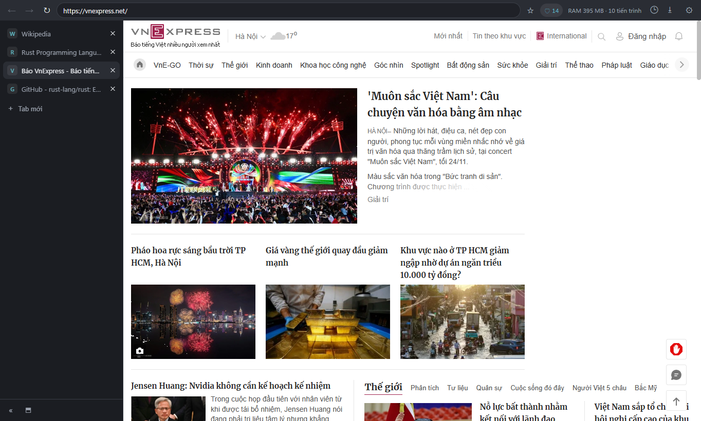
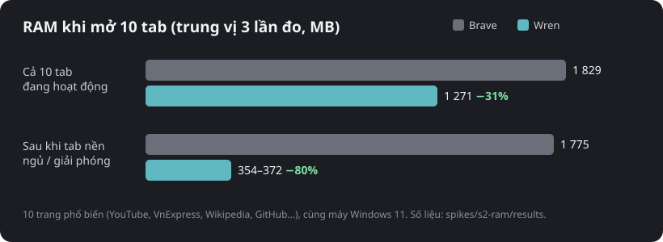

<h1 align="center">Wren</h1>

Trình duyệt viết bằng Rust trên WebView2: ít RAM nhất có thể, vẫn tiện như trình duyệt thông thường.

<a href="https://github.com/daophamquoc/wren-releases/releases/latest"><b>⬇ Tải bản mới nhất</b></a>

Repo này chỉ chứa bộ cài và ghi chú phát hành. Wren tự kiểm tra bản mới ở đây (Cài đặt → Phiên bản).

- **Nhẹ RAM**: tab nền tự ngủ sau 5 phút, giải phóng sau 30 phút; ít hơn 31–80% RAM so với trình duyệt Chromium thông thường trên cùng 10 trang.
- **Shields** chặn quảng cáo và tracker, nâng HTTPS, chống fingerprint, cửa sổ riêng tư.
- **Tab dọc**, lịch sử, bookmark, trình tải có sẵn và tích hợp [PQDown](https://github.com/daophamquoc/pqdown-releases/releases/latest).

Yêu cầu: Windows 10/11 64-bit, Microsoft Edge WebView2 Runtime (Windows 11 có sẵn).